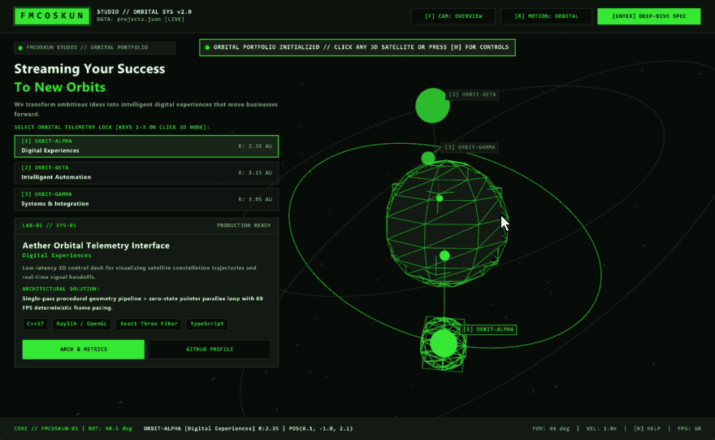
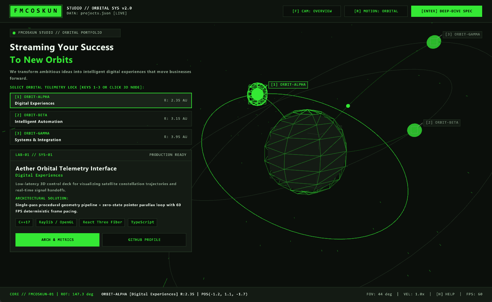
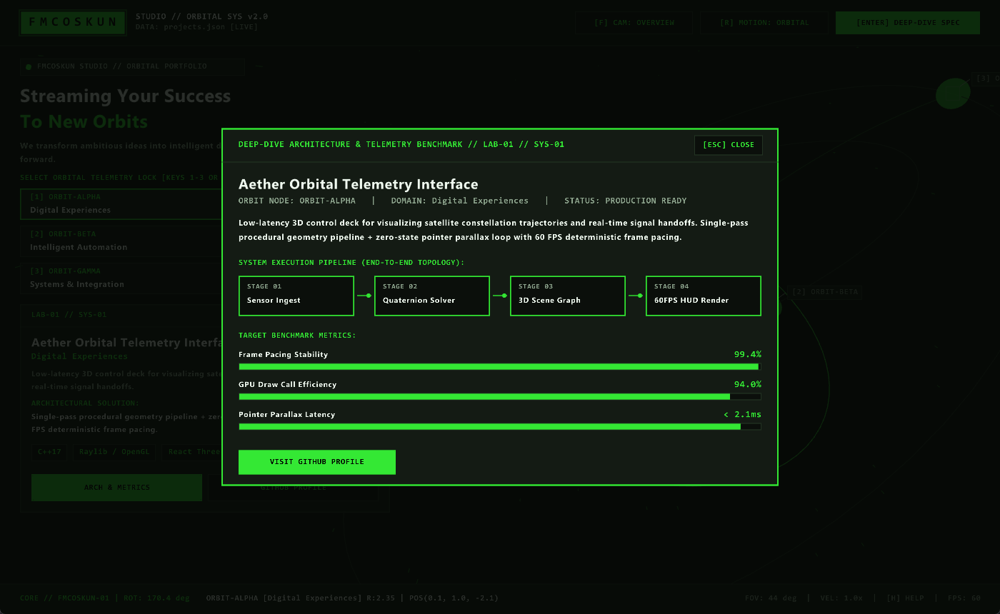

# FMCOSKUN STUDIO — Orbital 3D Portfolio

> *Streaming Your Success To New Orbits*

An interactive 3D desktop portfolio written in **C++17** with **raylib**. Each project
is a satellite orbiting a central studio core. Select one to see its summary,
architecture note, tech stack and execution pipeline. All content comes from
`projects.json` and reloads live when you save the file.



| Main view | Deep-dive modal |
|---|---|
|  |  |

## Features

- **3D orbital scene**: tilted procedural orbit rings, Bezier signal streams, a pulsing wireframe core and a rotating star field
- **Ray-cast selection**: click a satellite to lock onto its project, or click the core to fire a shockwave and reset the camera
- **Orbit camera**: right-drag to rotate, scroll to zoom, `F` to follow the selected satellite, plus pointer parallax
- **Deep-dive modal**: a pipeline diagram and benchmark bars for each project
- **Data-driven content**: a zero-dependency JSON parser (`include/MiniJson.hpp`) with line/column error reporting, built-in fallback data and auto-reload on file change
- **Responsive HUD**: the layout adapts to window size, long text wraps or truncates, and orbit cards switch to a compact mode when space is tight
- **Accessibility**: a reduced-motion mode (`R`) and an in-app control reference (`H`)

## Controls

| Input | Action |
|---|---|
| Left click | Select a satellite / pulse the central core |
| Right drag | Orbit the camera |
| Mouse wheel | Zoom (FOV) |
| `1`–`9`, `Tab` / `Shift+Tab` | Select orbit node |
| `Enter` | Open the deep-dive modal |
| `F` / `C` | Follow the selected satellite / reset the camera |
| `S` / `R` | Toggle signal streams / reduced motion |
| `↑` / `↓` | Orbit velocity multiplier |
| `L` | Reload `projects.json` (it also auto-reloads on save) |
| `Space` | Replay the logo flip |
| `F11` / `F12` | Fullscreen / timestamped screenshot |
| `H` / `Esc` | Help panel / close the active panel |

## Building

Requires a C++17 compiler and [raylib](https://www.raylib.com/) 4.5 or newer.

**Windows (MSYS2 / MinGW)**

```bash
pacman -S mingw-w64-x86_64-gcc mingw-w64-x86_64-raylib mingw-w64-x86_64-make
mingw32-make          # build
mingw32-make run      # build and launch
mingw32-make test     # run the JSON parser tests
```

**CMake (any platform)**

```bash
cmake -B build
cmake --build build
ctest --test-dir build
```

## Customizing content

Edit `projects.json`. Each entry in `orbits` becomes one satellite:

```json
{
  "githubProfile": "https://github.com/fmcoskun",
  "orbits": [
    {
      "id": "ORBIT-ALPHA",
      "label": "Digital Experiences",
      "radius": 2.35, "tiltX": 0.42, "tiltZ": -0.25,
      "angularSpeed": 0.45, "initialPhase": 0.40, "nodeSize": 0.16,
      "title": "Project title",
      "summary": "One or two sentences.",
      "techStack": ["C++17", "raylib"],
      "pipeline": ["Stage A", "Stage B", "Stage C"],
      "metrics": [{ "label": "Metric", "value": "95%", "ratio": 0.95 }],
      "repoUrl": "https://github.com/fmcoskun/some-repo",
      "liveUrl": "https://example.com"
    }
  ]
}
```

`repoUrl` and `liveUrl` are optional. Without `repoUrl` the GitHub button opens
`githubProfile`, and without `liveUrl` the live demo button is hidden. Numeric
values are clamped to safe ranges. If the file is malformed, the app keeps
running on built-in data and shows the parse error on screen.

## Project structure

```
main.cpp                     App controller, HUD, typography, input
include/OrbitalEntities.hpp  3D scene entities (OOP hierarchy)
include/PortfolioConfig.hpp  Design tokens, data models, config loader
include/MiniJson.hpp         Zero-dependency recursive-descent JSON parser
tests/json_test.cpp          Parser and loader tests
projects.json                Portfolio content
```

## License

[MIT](LICENSE)
